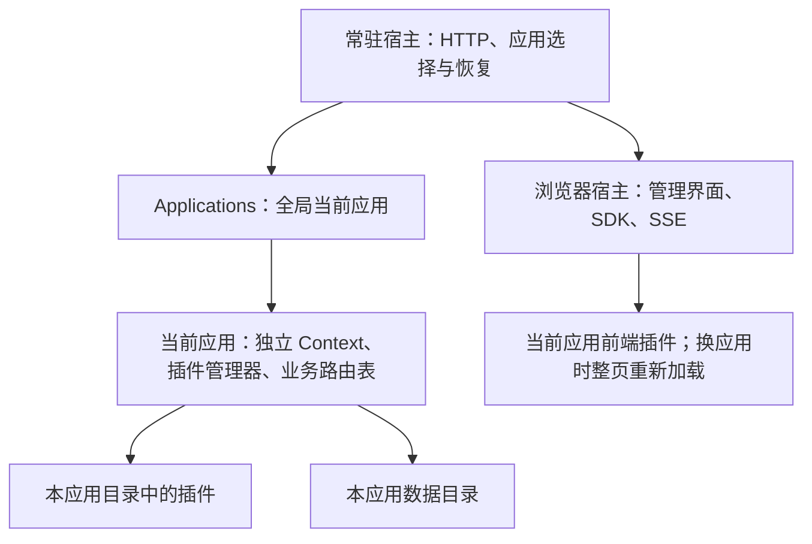

# 应用开发与切换指南

一个应用拥有自己的插件目录和数据空间；宿主一次只打开一个应用。笔记与画图可以有同名插件，但不共享业务服务、启用状态或配置。通用宿主与 SDK 不属于某一个应用。

## 1. 目录与最小清单

```text
applications/drawing/
  package.json
  assets/icon.svg
  plugins/storage/package.json
  plugins/storage/server.js
  plugins/canvas/package.json
  plugins/canvas/client.js
  plugins/canvas/server.js
  plugins/canvas/style.css
```

应用 `package.json`：

```json
{
  "name": "@applications/drawing",
  "version": "1.0.0",
  "private": true,
  "type": "module",
  "cordisApp": {
    "id": "drawing",
    "name": "画图",
    "description": "独立的画布、画笔和作品存储。",
    "icon": "assets/icon.svg"
  }
}
```

`id` 与文件夹名一致，使用 2–50 位小写字母、数字和连字符，首字符为字母；`name` 必填。描述和图标可省略。`default: true` 表示没有已保存选择时默认打开该应用，仓库只给笔记设置此字段。正式运行的宿主读取应用清单与声明图标，不扫描或执行未打开应用的插件。添加或修改应用清单后重启服务。Vite 开发工具会扫描全部应用、校验清单，后端源码按需转换，但仍只执行当前应用的已启用插件；清单变更自动触发保存后的增量登记和插件加载，业务后端无需重启，详见 [Vite 开发与热更新](Vite开发与热更新.md)。

应用清单不重复登记插件列表或入口。插件沿用自己的 `package.json.cordis` 协议，宿主只扫描当前应用的 `plugins/*/package.json`。同一应用内插件 ID 唯一；不同应用允许重复 ID。pnpm workspace 的包名需全仓库唯一，例如 `@cordis-notebook/storage` 和 `@cordis-drawing/storage`。具体插件声明见 [Workspace 插件开发指南](Workspace插件开发指南.md)。

## 2. 宿主与应用边界



HTTP 监听器始终保留；业务路由随当前应用注册和清理。插件使用 `ctx.http.route(owner, ...)` 登记路由，使用 `sdk.request()` 发出请求。宿主没有笔记或绘图服务的分支判断。

前端可直接向通用 `app` 挂载点挂载界面，也可由自己的布局插件细分插槽。宿主不要求 React；笔记应用内由自己的 UI 插件统一提供 React，画图示例使用原生 DOM。各应用需要公共能力时，在自己目录放置自己的插件包；不跨应用导入插件实现或调用服务。

这是生命周期与数据归属的约定，不是安全沙箱。完全信任的插件仍有当前进程权限。若插件自行写全局变量、访问别的目录或遗留子进程，Cordis 不能自动撤销；通过开发规范与资源清理约定处理，不另加权限系统。

## 3. 切换流程

1. 发起页面执行 `plugins/before-stop`，`reason: 'application'`，targets 为当前所有启用插件。编辑器保存内容，并通过 `hold()` 锁住编辑；保存失败则取消。
2. 后端串行处理切换，核对页面的应用 session；预检目标插件清单与 dist。预检失败时当前应用不停止。
3. 进入 switching 阶段，拒绝新的应用请求，等待已接收请求完成。尚有未确认的插件配置或互斥切换时，拒绝应用切换。
4. 释放旧管理器与整个业务 Context，清空业务路由；生成新的 session。旧应用停止后再创建新应用 Context，按自己的启用状态和配置加载。
5. 后端启动成功后保存当前选择。启动失败则尝试重新打开原应用；恢复失败时停留在常驻选择界面，显示错误。
6. SSE 通知所有页面；页面备份待恢复草稿、清理旧插件并刷新。新页面只加载当前应用的前端资源。前端加载失败通过插件管理器重载、停用或切换应用；这一阶段没有自动回退整套后端应用的确认事务。

应用选择为服务级全局状态。多个标签页可打开页面，但不能各自运行不同应用。只有发起页有机会拒绝切换；其他页面通过草稿保留未保存内容。直接调用后端接口不能代替浏览器保存准备协议。

`GET /api/applications` 返回 `{session,current,phase,error,applications}`。`POST /api/applications/switch` 发送 `{id,session}`；`id: null` 关闭当前应用并记住关闭状态。所有应用写入和插件管理写入须携带 `X-Application-Session`，SDK 自动附加。旧 session 返回 409，避免旧页面写进新应用。前端模块与样式 URL 也带 `appSession` 参数。此标识用于防止串应用，不是身份认证令牌。

## 4. 数据与旧版迁移

```text
data/applications-state.json            {"active":"notebook"} 或 {"active":null}
data/apps/<app>/plugins-state.json      该应用的插件启用选择
data/apps/<app>/plugins-config.json     该应用的插件设置与版本
data/apps/<app>/plugin-data/<plugin>/   后端 runtime.dataDir
```

`runtime.appDataDir` 为 `data/apps/<app>/`；新私有数据使用 `runtime.dataDir`。笔记旧存储约定保留在笔记插件中，使用应用数据目录中的 `notes.json`。

前端 `sdk.application` 提供应用 ID 与名称，`sdk.storage.local/session` 提供 Storage 接口，物理键前缀为 `cordis:app:<app>:plugin:<plugin>:`。`clear()` 只清理该插件空间。插件自行设计草稿恢复和冲突策略，宿主不解释业务内容。

笔记清单的 `legacyData` 列出旧数据根目录的 `notes.json`、`plugins-state.json`、`plugins-config.json`、`plugin-data` 和 `note-assets`。首次打开且目标应用数据目录不存在时，复制到临时目录，完成后原子改名；原文件不删除。目标已存在时不再次导入，避免覆盖后续数据。应用声明 `legacyBrowserStorage: true`，由笔记插件与自由页面插件迁移自己的旧浏览器键；宿主不认识这些具体键。笔记草稿按各标签页首次使用新版存储的时机迁移，不提前复制其他标签页的草稿；保留旧备份，并记录每份草稿的迁移状态，避免覆盖新版编辑内容或在保存后再次恢复旧草稿。

升级后只写入 `data/apps/notebook/`。回退旧代码前，先停服务并备份新目录，再显式将新数据恢复到旧版使用的位置；直接启动旧版只会看到迁移前的旧根目录数据。自定义 `file` 路径的历史开发实例继续使用兼容入口，不会自动将外部目录迁入应用空间。

## 5. 构建、测试与导出

```sh
pnpm install --frozen-lockfile
pnpm build                  # 全部应用及宿主
pnpm build drawing          # 指定应用及宿主
pnpm test
pnpm export:app drawing work/drawing-release
pnpm --dir work/drawing-release install
```

导出目标必须不存在，父目录须存在。结果为新的应用目录集合：`work/drawing-release/drawing/{package.json,assets,plugins}`，插件只有清单和 dist。导出根目录带独立 pnpm workspace，普通 npm 依赖由这里安装；不携带笔记应用、源码或用户数据。

保留通用宿主及其依赖、`public/runtime.js`，运行（PowerShell）：

```powershell
$env:APPLICATIONS_DIR = (Resolve-Path 'work/drawing-release').Path
$env:DATA_DIR = Join-Path (Get-Location).Path 'work/drawing-release-data'
$env:APP = 'drawing'
pnpm start:runtime
# 停服务后恢复默认开发环境：
Remove-Item Env:APPLICATIONS_DIR, Env:DATA_DIR, Env:APP
```

导出不包含 Node 和宿主。不要用源码构建命令 `pnpm start` 重建导出物；运行使用 `start:runtime`。首次安装后保存发行目录锁文件，后续用 `--frozen-lockfile`。

测试使用 `createHost({port:0,dataDir,applicationsDir?})`。现有 `createApp({pluginsDir,dataDir,file?,port:0})` 为单目录兼容测试入口，直接使用传入的数据根目录，不强制旧测试携带应用 session。不要混淆两种入口的数据路径。旧 `pnpm export:plugins <目录>` 仍可导出默认应用的一组插件，配合 `PLUGINS_DIR`；新应用交付优先使用 `export:app`。

`test/applications.test.js` 验证复制迁移、图片兼容、数据和设置恢复、同名插件隔离、过期请求拒绝、请求排空、失败恢复和导出。现有笔记、自由页面、配置与生命周期回归继续保留；真实浏览器还应验证切换前保存、界面与样式清理、多个标签页跟随以及插件启停。
