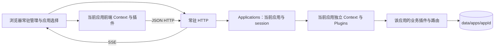
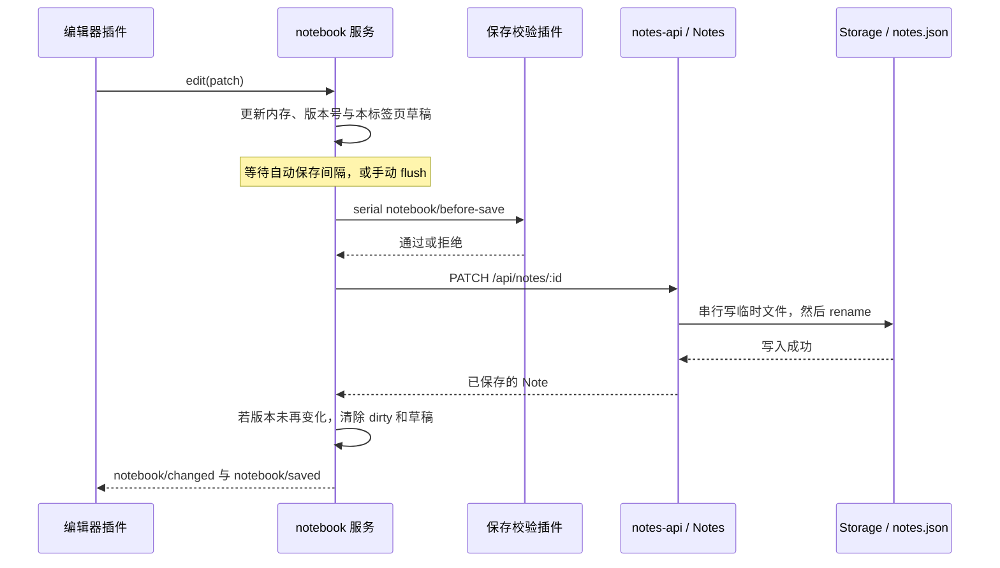

# Cordis 插件应用宿主：项目接手与维护指南

面向第一次接触项目的开发者与维护者。目标是帮助你独立启动项目、找到修改入口、添加插件，并在出现故障时判断应该检查哪一层。

**文档基线：2026-10-04，包含独立应用目录、单应用切换、workspace 插件化、旧第三方 API 移除及 Vite 源码开发、插件动态加载与正式构建。应用层协议见 [应用开发与切换指南](应用开发与切换指南.md)。** 具体清单、类型与构建协议见 [Workspace 插件开发指南](Workspace插件开发指南.md)。

仓库：[Asuta/cordis-notebook](https://github.com/Asuta/cordis-notebook)。当前是私有仓库，接手者需要先获得仓库访问权限。

## 阅读路线

| 你的任务 | 建议先读 |
| --- | --- |
| 先把应用跑起来 | [快速开始](#quickstart) → [开发与构建](#development) |
| 理解项目为什么这样组织 | [项目定位](#overview) → [架构与源码地图](#architecture) → [插件与依赖](#plugins) |
| 修改笔记、保存或草稿 | [笔记数据流](#notes) → [数据与备份](#data) |
| 新增功能插件 | [扩展开发](#extension) → [测试与验收](#testing) |
| 修改设置面板或配置行为 | [配置系统](#settings) |
| 修复启停、主题、加载问题 | [生命周期](#lifecycle) → [主题切换](#themes) → [故障排查](#troubleshooting) |
| 准备交付下一个版本 | [提交与更新流程](#delivery) → [已知边界](#limits) |

配套文档：[内置插件服务契约](内置插件服务契约.md) 是服务、事件及配置 SDK 的接口说明；[Workspace 插件开发指南](Workspace插件开发指南.md) 介绍当前的清单、构建和运行包流程。本文负责把这些接口放回完整工程流程中。

<a id="overview"></a>
## 1. 项目定位与现状

这是一个本地、单用户的插件应用宿主，同时附带笔记和基础画图两个独立应用。同一服务一次运行一套应用插件，可在页面右上角切换。以下笔记相关章节专指笔记应用。笔记编辑、搜索、置顶、统计、摘要、主题和布局均由插件提供，可以在页面中启停。

“由插件组成”的工程边界如下：

- **常驻宿主**负责启动、HTTP、应用发现与切换、插件管理、状态同步、设置窗口和恢复入口。关闭布局后仍可以打开管理器重新启用功能。
- **应用插件**分别放在 `applications/<app>/plugins/`，负责所属应用的业务与界面，不跨应用共享。
- **Workspace 插件**统一由清单发现、构建和加载。后端在宿主 Node 进程内执行，可访问文件、网络和命令，使用当前账户权限；不提供安全沙箱或进程隔离。

前端由 UI 插件提供共享 React 运行时，业务插件拥有各自的 React 视图或原生 DOM 编辑器；后端是 Node.js HTTP 服务，没有 Express、数据库服务器或云端笔记服务。基础应用启动不需要 API Key、数据库账户或外部模型服务。可选的 [Agent 工作台](Agent工作台设计与使用.md) 使用独立 Pi 进程和 DeepSeek API，运行 `pnpm workbench` 启动，密钥在工作台设置中配置。

| 技术 | 当前用途 |
| --- | --- |
| Node.js 22.19+ | 本地 HTTP 服务、文件存储、应用与插件生命周期、测试及 Pi Agent |
| pnpm | 依赖安装、脚本运行；提交 `pnpm-lock.yaml` |
| Cordis `4.0.0-rc.10` | 服务注入、事件、插件与资源生命周期；固定版本 |
| React、shadcn/ui、Tailwind CSS、Lucide | UI 服务插件提供组件、图标、主题样式和 React 渲染，消费插件拥有自己的视图 |
| Vite | 浏览器源码开发、依赖预构建、CSS/Tailwind 更新、宿主与插件的正式前端构建 |
| esbuild | 后端插件构建和开发重启前的编译检查，npm 依赖保持 external |
| TypeScript | 检查公共类型声明及类型示例；没有对全部 JS 开启类型检查 |
| Node 原生测试运行器 | 运行 `test/*.test.js` |

笔记应用提供 34 个 workspace 插件，画图应用另有 2 个。全新数据目录默认运行 25 个基础功能、界面与 Agent 工具插件和苔绿主题；保存后摘要、晴蓝主题、墨夜主题、琥珀主题、紫藤主题、海盐主题、石墨主题、可可主题默认关闭。React 挂载与服务依赖见 [React 界面插件开发指南](React界面插件开发指南.md)。

<a id="quickstart"></a>
## 2. 快速开始：从零到第一次保存

### 2.1 获取代码与启动

以下命令在 PowerShell 或常见终端中逐行执行：

```sh
git clone https://github.com/Asuta/cordis-notebook.git
cd cordis-notebook
node --version
pnpm --version
pnpm install --frozen-lockfile
pnpm test
pnpm start
```

`pnpm` 命令必须事先可用。仓库没有固定 `packageManager` 字段；复现依赖使用锁文件，不要用 npm 重新生成另一套锁文件。若 `--frozen-lockfile` 报不一致，先核对代码和锁文件是否来自同一提交。

打开 [本地笔记本](http://127.0.0.1:3210/)。`pnpm start` 会先构建浏览器运行时，然后保持后端进程运行。关闭服务时在启动终端按 Ctrl+C。

全新克隆没有原作者的笔记与个人插件配置，因为 `data/` 不进入 Git。第一次看到空笔记列表是正常结果；点击「新建」后输入内容，等保存状态变成“已保存到本地”。

### 2.2 第一次验收建议

1. 创建一篇测试笔记，输入标题和正文，确认保存成功；刷新后仍能读取。
2. 打开「插件管理」，停用「全文搜索」，确认搜索框消失；重新启用后恢复。
3. 在插件中心切换功能、外观、基础能力和依赖关系，确认详情与服务依赖可见；停用插件中心界面后应回到宿主管理入口并能重新启用。
4. 开启「保存后摘要」，编辑正文并保存，确认页面下方出现摘要。
5. 在「字数统计 → 设置」切换是否统计空格，确认计数即时更新。
6. 在「前端笔记服务 → 设置」修改自动保存间隔，确认重载完成、笔记内容保留。

在接手者自己的新数据目录进行这些操作。不要用已有用户的重要笔记做删除或故障注入测试。

### 2.3 改端口

PowerShell：

```powershell
$env:PORT = '3211'
pnpm start
```

另一个终端启动新进程前，要确认原进程已经退出。**改端口不会改数据目录**；两个默认启动进程仍会同时写同一份 `data/`，这是不支持的。

服务默认绑定 `127.0.0.1`。入口支持 `PORT`、`DATA_DIR`、`APPLICATIONS_DIR`、`APP`；不支持 `HOST` 或 `.env` 自动加载。旧 `PLUGINS_DIR` 切入单目录兼容模式。

### 2.4 只读检查服务

```powershell
$baseUrl = 'http://127.0.0.1:3210'
$snapshot = Invoke-RestMethod "$baseUrl/api/plugins"
$snapshot.plugins | Select-Object id, enabled, state, serverState
Invoke-RestMethod "$baseUrl/api/notes"
```

`/api/plugins` 是管理快照，不包含当前浏览器页面自己的前端 Fiber 状态。前端运行是否正常还要看管理器和浏览器控制台。项目没有单独的 `/api/health` 路由。

<a id="development"></a>
## 3. 日常开发与构建方式

### 3.1 常用命令

| 命令 | 实际行为 |
| --- | --- |
| `pnpm install --frozen-lockfile` | 根据锁文件安装依赖 |
| `pnpm build` / `pnpm build drawing` | 构建全部应用 / 指定应用，均生成宿主 runtime；产物忽略提交 |
| `pnpm start` | 构建后启动 Node 服务 |
| `pnpm start:runtime` | 不构建；用 APPLICATIONS_DIR 指定应用集合、APP 指定启动选择；旧 PLUGINS_DIR 仍为单目录入口 |
| `pnpm export:app <id> <新目录>` | 导出指定应用的元数据、图标与插件清单和 dist，不含用户数据 |
| `pnpm export:plugins <新目录>` | 导出插件清单和 dist；目标目录须不存在，输出目录需另行安装 npm 依赖 |
| `pnpm dev` | Vite 提供前端源码和 HMR；Module Runner 执行后端源码，新增或修改插件保存后原地更新，无需生成 dist |
| `pnpm typecheck` | 检查宿主类型、各插件 types 与根目录/插件目录的类型测试 |
| `pnpm test` | 类型检查 → 构建 → 全部 Node 运行时测试 |

### 3.2 改了哪些文件，需要做什么

日常修改运行 `pnpm dev`，更新行为见 [Vite 开发与热更新](Vite开发与热更新.md)。它与正式运行使用相同插件清单、Cordis 服务依赖及数据目录；不要让开发服务和正式服务同时写同一份数据。

| 修改位置 | Vite 开发模式 | 正式运行 |
| --- | --- | --- |
| `client/host/` 宿主模块、`public/index.html` | 页面保存后整页刷新 | 构建后刷新浏览器 |
| 插件 JS/TS/JSX 和本插件相对实现 | 保存后重建受影响前端插件及其服务消费者 | 构建后刷新；含后端变更时还需重启 |
| 插件声明的 CSS、Tailwind、`public/style.css` | Vite 更新样式，无需整页刷新 | 构建后刷新浏览器 |
| 后端插件源码、应用/插件清单 | 校验且页面保存后原地更新，后端 PID 与页面保持不变 | 构建后重启服务并刷新 |
| `server/`、`shared/` 宿主实现 | 保存后重启后端并刷新页面 | 构建后重启服务并刷新 |
| 新增依赖和锁文件 | 运行 pnpm install，安装完成自动重试待加载插件 | 安装、构建并重启 |
| `scripts/`、宿主共享运行库升级 | 重新运行 pnpm dev | 安装、构建并重启 |
| `packages/host/`、插件 `types/`、类型测试 | 运行 `pnpm typecheck` | 运行 `pnpm typecheck` |

Vite 处理模块转换、依赖和缓存；Cordis 负责插件的释放、依赖等待及重新激活。前端编译失败时先显示错误并保留当前实例；后端转换或页面保存失败时取消插件替换；后端激活失败尝试恢复旧实现。插件重载不承诺保留组件局部状态，重要编辑内容应通过已有保存和草稿协议保护。

`public/runtime.js` 是生成文件，被 `.gitignore` 排除。新克隆必须构建；不要手改生成文件来修复功能。

### 3.3 独立数据目录与隔离运行

测试和实验用 [createApp](../server/server.js) 传入独立文件路径，避免改写正在使用的笔记。可在项目根目录新建 `work/sandbox-server.mjs`：

```js
import { resolve } from 'node:path'
import { createApp } from '../server/server.js'

const app = await createApp({
  port: 0,
  file: resolve('work/sandbox-data/notes.json'),
})
console.log(`http://127.0.0.1:${app.server.address().port}`)
for (const signal of ['SIGINT', 'SIGTERM']) {
  process.once(signal, async () => {
    await app.close()
    process.exit(0)
  })
}
```

```sh
pnpm build
node work/sandbox-server.mjs
```

`port: 0` 让系统分配空闲端口；默认 `dataDir` 是所传 `file` 的父目录，因此这份实验的笔记、配置与插件专属数据都位于 `work/sandbox-data/`。`work/` 仅存临时材料，不进入 Git。

<a id="architecture"></a>
## 4. 架构与源码地图

### 4.1 宿主与应用运行环境



浏览器 Context 与主进程 Context 不共享服务对象或事件总线。`ctx.notebook` 在浏览器，`ctx.notes` 在 Node 主进程，二者通过 `notesApi` 的 HTTP 请求协作。插件需要跨前后端通信时，由插件自己通过 HTTP 服务注册业务路由。

因此，浏览器中 `ctx.on('notebook/saved', ...)` 不能直接订阅另一个页面或其他后端插件的所有写入。

### 4.2 按职责找源码

内置插件按 ID 聚合在 `applications/notebook/plugins/<id>/`：前后端入口分别是 client.js、server.js，单侧插件省略另一侧入口；专属样式、格式定义和辅助逻辑也放在同一目录。业务共享能力通过服务插件提供；shared 只放宿主公共代码。每个插件的 package.json 声明入口、依赖和公开资源；宿主通用发现器读取 JSON，不执行插件代码。

| 文件 / 目录 | 职责与常见修改原因 |
| --- | --- |
| [server/server.js](../server/server.js) | 应用组装、管理 API、SSE、静态文件路由、启动退出 |
| [server/host/applications.js](../server/host/applications.js) | 应用实例、切换排队、请求 session、复制迁移与失败恢复 |
| [server/application-discovery.js](../server/application-discovery.js) | 应用元数据发现；不执行未打开应用的插件 |
| [server/host/http.js](../server/host/http.js) | 本机监听、请求校验、JSON 解析、按上下文注册路由 |
| [server/builtins.js](../server/builtins.js) | 通用发现结果的兼容导出，不含业务注册；发现与校验实现位于 server/plugin-discovery.js |
| [applications/notebook/plugins/storage/server.js](../applications/notebook/plugins/storage/server.js) | 后端存储插件，读写与原子替换 JSON 文件 |
| [applications/notebook/plugins/notes-api/server.js](../applications/notebook/plugins/notes-api/server.js) | 后端笔记 HTTP API 插件，路由随插件卸载 |
| [applications/notebook/plugins/theme-engine/server.js](../applications/notebook/plugins/theme-engine/server.js) | 后端主题引擎服务，activate(owner, id) 创建归属主题插件的服务 |
| [applications/notebook/plugins/note-formats/note.js](../applications/notebook/plugins/note-formats/note.js) | 旧笔记格式兼容和通用深只读快照 |
| [applications/notebook/plugins/notes/server.js](../applications/notebook/plugins/notes/server.js) | 笔记 CRUD、字段校验、内存数据、串行写入队列 |
| [server/host/plugins.js](../server/host/plugins.js) | 插件记录、启动停止、依赖保护、互斥组确认与回滚 |
| [server/host/plugin-settings.js](../server/host/plugin-settings.js) | 配置版本、暂存事务、确认、持久化、失败信息 |
| [client/host/runtime.js](../client/host/runtime.js) | 浏览器宿主入口、SDK、管理按钮、SSE 与同步队列 |
| [client/host/plugin-host.js](../client/host/plugin-host.js) | 前端模块加载、Cordis Fiber、后端就绪门、配置应用与重载 |
| [shared/lifecycle.js](../shared/lifecycle.js) | 固定 Cordis 版本的状态映射、实际 Fiber 和服务绑定映射 |
| [shared/plugin-relations.js](../shared/plugin-relations.js) | 服务依赖与提供者的展示投影 |
| [client/host/dependency-graph.js](../client/host/dependency-graph.js) | 服务连线合并、双向可达关系、完整循环依赖检测 |
| [client/host/dependency-layout.js](../client/host/dependency-layout.js) | 从左到右的分层布局、减少交叉与循环回绕路径 |
| [client/host/dependency-view.js](../client/host/dependency-view.js) | 单节点依赖网图、搜索定位、缩放平移和详情面板 DOM |
| [client/host/stop-coordinator.js](../client/host/stop-coordinator.js) | 可拒绝的停止准备与最终释放锁 |
| [shared/config-schema.js](../shared/config-schema.js) | 前后端共用的配置值校验与默认值补齐 |
| [shared/config-binding.js](../shared/config-binding.js) | 前后端共用的单次激活配置值、监听器和取消信号；client/host/config-binding.js 保留兼容转发 |
| [client/host/mounts.js](../client/host/mounts.js)、[client/host/styles.js](../client/host/styles.js) | 通用挂载点注册，以及清单 CSS 的加载与生命周期清理 |
| [scripts/export-plugins.js](../scripts/export-plugins.js) | 插件运行包导出；不包含插件源码或构建声明 |
| [client/host/config-transaction.js](../client/host/config-transaction.js) | 发起页面的配置试用、确认和恢复 |
| [client/host/settings-view.js](../client/host/settings-view.js) | 根据 schema 生成表单，保留输入，显示版本冲突 |
| [applications/notebook/plugins/notebook/model.js](../applications/notebook/plugins/notebook/model.js) | 笔记前端模型、草稿、保存队列、过滤器、业务事件 |
| [applications/notebook/plugins/notebook/client.js](../applications/notebook/plugins/notebook/client.js) | 模型启动、标签页标识、选中笔记恢复、保存状态和快捷键 |
| [applications/notebook/plugins/layout/mounts.js](../applications/notebook/plugins/layout/mounts.js) | 挂载服务；节点归属消费插件并随其卸载清理 |
| `applications/notebook/plugins/<id>/` | 按插件 ID 聚合前后端入口、专属辅助模块和样式；新增功能从这里开始 |
| [client/contracts/index.d.ts](../client/contracts/index.d.ts) | 仅转发宿主通用类型；业务接口与事件在各插件 types/ 中 |
| [public/index.html](../public/index.html)、[public/style.css](../public/style.css) | 常驻管理壳与基础管理样式 |
| `test/` | 行为回归与类型使用示例 |
| `docs/` | 开发指南、服务契约与接手维护文档 |

### 4.3 启动过程

1. `createHost()` 扫描应用元数据，建立常驻 HTTP Context；根据保存的选择创建当前应用的独立 Context 与 Plugins 管理器。只扫描当前应用的插件清单和 dist。
2. 注册常驻管理、SSE 和静态资源路由。
3. 管理器读取已发现插件的启停选择与设置，修正互斥组选择，再启动已启用的插件记录；服务满足后才导入后端实现。
4. 浏览器加载 `public/runtime.js`，创建自己的根 Context 和管理界面。
5. 浏览器读取 `/api/plugins` 快照，加载启用的前端模块；Cordis 根据可用服务决定激活或等待，激活前等待清单声明的 CSS 就绪。
6. SSE 的 `plugins` 事件触发再次读取完整快照，前端同步宿主只处理需要变化的部分。

SSE 的 `plugins` 事件通知读取快照，`applications` 事件传当前应用元数据与 session，不传笔记内容。切换应用会释放旧业务 Context 并建立新 Context，HTTP 保持运行，所有页面清理旧插件后刷新。服务退出走 `app.close()`：先结束管理器操作与未确认事务，再停止插件并关闭根 Context、SSE 和 HTTP。

<a id="plugins"></a>
## 5. 内置插件与服务依赖

表中的服务名有前后端作用域；同名不表示跨进程共享。

| 插件 ID | 功能 | 后端需要 → 提供 | 前端需要 → 提供 |
| --- | --- | --- | --- |
| `storage` | 本地 JSON 存储 | 无 → `storage` | 无 |
| `markdown` | 解析与渲染能力 | 无 → `markdown` | 无 → `markdown` |
| `theme-engine` | 主题应用与清理能力 | 无 → `themeEngine` | 无 → `themeEngine` |
| `note-formats` | 格式注册 | 无 → `noteFormats` | 无 → `noteFormats` |
| `format-plain` | 普通笔记格式 | `noteFormats` | `noteFormats` |
| `format-freeform` | 自由页面格式 | `noteFormats` | `noteFormats` |
| `format-markdown` | Markdown 笔记格式 | `noteFormats`, `markdown` | `noteFormats`, `markdown` |
| `notes` | 笔记业务 | `storage`, `noteFormats` → `notes` | 无 |
| `notes-api` | 笔记 HTTP 与客户端请求服务 | `notes`, `http` → 路由 | 无 → `notesApi` |
| `layout` | 布局、样式、界面扩展位 | 无 | 无 → `shell` |
| `notebook` | 选择、草稿、保存、过滤 | 无 | `notesApi`, `shell`, `noteFormats` → `notebook` |
| `note-list` | 笔记列表 | 无 | `notebook`, `shell`, `noteFormats` → `noteListUI` |
| `editor-host` | 标题、删除和编辑器注册 | 无 | `notebook`, `shell`, `noteFormats` → `editorHost` |
| `editor` | 普通笔记正文 | 无 | `notebook`, `editorHost`, `noteFormats` |
| `free-page-editor` | 自由页面文字块 | 无 | `notebook`, `editorHost`, `noteFormats` |
| `markdown-editor` | Markdown 源码与预览 | 无 | `notebook`, `editorHost`, `noteFormats`, `markdown` |
| `search` | 全文搜索 | 无 | `notebook`, `noteListUI` |
| `pin` | 置顶与筛选 | 无 | `notebook`, `noteListUI`, `shell` |
| `export` | TXT 导出 | 无 | `notebook`, `shell` |
| `stats` | 字数统计 | 无 | `notebook`, `shell` |
| `note-summary` | 保存后摘要 | 无 | `notebook`, `shell` |
| `theme` | 苔绿主题 | `themeEngine` → `theme` | `shell`, `themeEngine` → `theme` |
| `theme-blue` | 晴蓝主题 | `themeEngine` → `theme` | `shell`, `themeEngine` → `theme` |
| `theme-night` | 墨夜主题 | `themeEngine` → `theme` | `shell`, `themeEngine` → `theme` |
| `theme-amber` | 琥珀主题 | `themeEngine` → `theme` | `shell`, `themeEngine` → `theme` |
| `theme-rose` | 紫藤主题 | `themeEngine` → `theme` | `shell`, `themeEngine` → `theme` |
| `theme-teal` | 海盐主题 | `themeEngine` → `theme` | `shell`, `themeEngine` → `theme` |
| `theme-graphite` | 石墨主题 | `themeEngine` → `theme` | `shell`, `themeEngine` → `theme` |
| `theme-cocoa` | 可可主题 | `themeEngine` → `theme` | `shell`, `themeEngine` → `theme` |

`http` 是后端常驻宿主服务。即使一个内置插件只有前端，后端管理器仍有对应记录和控制 Fiber；这不代表它有实际后端业务。管理器用 `serverState: not-applicable` 表示无需后端业务运行。

### 三种关系不要混用

- **服务依赖**：内置清单 `requires.client/server`，通过 Cordis inject 控制激活。`provides` 是清单元信息；插件必须实际注册服务，写上名称不会自动创建服务。
- **代码包依赖**：插件 package.json 的 dependencies 由 pnpm 安装，通过 API packageDependencies 展示，不进入服务启动拓扑。

依赖关系页采用网图，每个插件只显示一次。服务提供者在左，使用者在右；连线从提供者的右端口接到使用者的左端口，箭头指向使用者。同一对插件的多个前后端服务合并为一条连接，点击连接查看具体服务。实线表示至少一个服务已有实际绑定；全部未绑定时用虚线表示候选关系，详情逐项说明。缺失或无法确定唯一提供者的服务在详情里提示，不制造插件节点或随意选择候选。代码包依赖、互斥组候选不进入服务连线。

网图支持搜索名称或 ID 后定位、滚轮与按钮缩放、拖动空白平移、适应全部、定位所选；点击节点仅突出直接依赖与直接使用者，其余内容淡化，间接依赖保留在详情里。键盘可搜索、选择节点、打开连线详情；画布聚焦后用方向键平移、加减号缩放、0 适应全部。状态更新复用节点与视口；只在节点或连线拓扑改变时重排。循环依赖按强连通分量分层并用回绕线标识，节点不重复。窗口尺寸观察器随消费插件生命周期释放。

增强插件中心和宿主后备管理界面共用这套视图。`pluginManagement.dependencyTree(owner)` 保留原调用名以兼容已有消费插件，但现在返回网图。旧的 `tree` 浏览偏好同样兼容，无需重置用户设置。网图只是展示投影，不是运行时调度器，不能用显示顺序决定真实启动顺序。前端的 `backend:<id>` 就绪门用于跨 HTTP 边界协调，不应作为业务插件的公共依赖。

<a id="lifecycle"></a>
## 6. 启停、状态与资源归属

### 6.1 状态字段的含义

| 字段 | 含义 |
| --- | --- |
| `enabled` | 用户保存的启用选择，不等同于已经运行 |
| `state` | 后端快照中的管理状态；页面会结合本页状态生成综合显示 |
| `serverState` | 后端业务状态，或 `not-applicable` |
| `clientState` | 本页面前端宿主计算的状态，不是后端 API 的全局事实 |
| `waitingFor` | 缺失的服务或后端就绪条件 |
| `bindings` | 服务实际绑定的提供方，用于展示与诊断 |
| `generation` | 后端插件激活代次，用于让页面撤销失效实例 |
| `configRevision` | 已提交配置的版本号，用于冲突检测 |

生命周期状态包括 `waiting / starting / enabled / failed / disabled / stopping`。`await ctx.plugin(...)` 返回后仍要看实际状态，不能仅凭调用完成就宣布“运行中”。缺少服务时可以保留启用选择并等待，提供者恢复后由 Cordis 重新激活。

Cordis 版本相关的数字状态映射集中在 `shared/lifecycle.js`。升级 Cordis 时，首先复核这里以及 `actualFiber()`、`fiber.store` 绑定映射，而不是只改依赖版本。

### 6.2 用户主动停用与服务突然消失

页面发起停用时，先运行停止准备，再调用后端 toggle。后端通过依赖保护拒绝停用仍被使用的提供者，用户需要先停依赖方。

底层服务突然消失时，Cordis 撤销消费者并清理资源；服务恢复后再激活。直接调用内部 `manager.stop()` 不等同于用户 toggle，它绕过了管理页面的准备流程及 toggle 的依赖保护，适合受控的内部流程或测试，不应成为新的 UI 操作捷径。

### 6.3 准备阶段可以拒绝，卸载阶段只清理

`StopCoordinator.run()` 发出 `plugins/before-stop`。监听器可以保存数据、登记锁的释放函数，返回错误文字或抛错以取消变更。

```js
ctx.on('plugins/before-stop', async request => {
  lockEditing()
  request.hold(() => unlockEditing())
  await savePendingWork()
})
```

`hold()` 必须在等待异步工作之前登记。锁直到动作完成或失败后才释放。`reason` 包括 `disable / reload / switch / configure / application`；普通插件操作的 targets 只列直接对象，切换应用则列出全部启用插件。

资源清理使用 `ctx.effect`、`ctx.on` 和 SDK 的拥有者绑定能力：

```js
const timer = setInterval(refresh, 1000)
ctx.effect(() => () => clearInterval(timer))
ctx.on('notebook/saved', onSaved)
ctx.shell.mount(ctx, 'panels', panel)
```

不要在 dispose 清理函数中发起新的保存或试图取消卸载。这里可能已经失去所依赖服务。异步资源应在创建后及时登记清理，不要等整个启动函数结束才处理。

该准备协议只约束发起操作的页面。其他页面停用、直接 API 调用、进程崩溃和关闭浏览器都可能绕过它。

<a id="notes"></a>
## 7. 笔记、自动保存与草稿的数据流

### 普通笔记、自由页面与 Markdown

新增笔记使用已注册的 type，目前自带 plain、freeform 和 markdown；旧数据缺少 type 时按 plain 读取，不需要批量迁移。自由页面附带 `blocks: [{id,x,y,width,text}]`，正文由文字块按 y、x 顺序提取。坐标非负且不超过 10000000，宽度范围 120–4000，最多 1000 块，总正文限制仍为 200000 个 JS 字符。服务端独立验证并生成正文；普通笔记不能写 blocks，不提供格式转换接口。

`applications/notebook/plugins/editor-host/client.js` 提供标题、删除和 `editorHost` 视图注册；`applications/notebook/plugins/editor/`、`applications/notebook/plugins/free-page-editor/`、`applications/notebook/plugins/markdown-editor/` 的 client.js 分别注册三种编辑器。缺少对应编辑器时只显示提示，数据仍保留。`applications/notebook/plugins/note-formats/registry.js` 提供格式注册，`applications/notebook/plugins/format-*/format.js` 保存各格式前后端共用的校验，`applications/notebook/plugins/free-page-editor/history.js` 管理当前实例的最多 80 步文字块撤销/重做，刷新后不保留历史。

Markdown 将原始源码保存在 `markdown` 字段（最多 200000 个 JS 字符），由共用解析器派生 `content`，复用通用保存、草稿、搜索和统计。编辑器提供分栏、编辑、预览三种模式、格式插入按钮与原始 `.md` 导出；标题独立保存，不自动写入导出的源码。任务列表预览只读，禁用原始 HTML；暂不支持公式、图表或代码高亮。解析源码为 `applications/notebook/plugins/markdown/parser.js`，开发模式修改后自动触发保存后重启，正式运行执行 `pnpm build` 并重启后端、刷新前端；不能手改生成的 `dist/` 文件。回归见 `test/markdown.test.js` 及前端草稿契约测试。

自由页面复用笔记保存队列和浏览器草稿，PATCH、草稿恢复均保留完整 blocks。滚动位置与缩放按笔记写入 `sdk.storage.session` 的 `cordis-page-view-<noteId>`，兼容旧 scroll 键。TXT 导出丢失布局，JSON 导出保留完整页面，目前没有导入界面。回退到不支持此格式的旧代码前必须备份整个 data 目录，不要用旧版编辑自由页面。

验收：新建自由页面，双击创建两块中文文字，拖动、调整宽度、删除后撤销，确认边缘自动滚动；保存后刷新核对位置与文本；切换普通笔记再返回，检查滚动位置；停用/恢复自由页面编辑器，验证提示与数据保留。自动化回归见 `test/free-page.test.js` 和 `test/notebook-contracts.test.js`。

### 7.1 从一次输入到磁盘保存



前端保存排队，保存期间仍可继续编辑。只有返回结果对应当前修订时才清除脏状态；有新修订则继续保存。切换笔记、新建和删除通过 `perform()` 先处理当前保存，避免把旧草稿写到新选中的笔记。

后端 `Notes.mutate()` 复制现有数据，在写文件成功后才替换内存数据；队列失败不会永久阻塞后续请求。Storage 写入 `notes.json.tmp`，然后 rename 为 `notes.json`。这是单进程串行替换，不是数据库事务、跨进程文件锁或断电持久性承诺。

### 7.2 业务事件

| 事件 | 分发方式与用途 |
| --- | --- |
| `notebook/changed` | 并行通知；原因含 edit、selection、filters、status |
| `notebook/before-save` | 串行校验；返回文字或抛错拒绝，undefined / null / false 表示通过 |
| `notebook/saved` | PATCH 成功后的只读结果通知；用于摘要等扩展 |

通知处理器异常会被报告，但不会把已经完成的磁盘写入标成保存失败。校验处理器不要再次调用 `flush()`，否则可能等待自身。

`notebook/saved` 不是创建、删除、其他后端插件写入或所有标签页操作的统一审计日志。当前也没有笔记内容的跨页面实时同步；SSE 主要同步插件状态与配置。

### 7.3 草稿恢复的准确边界

每次编辑都会尝试备份到 localStorage。标签页 UUID 存在 sessionStorage，草稿键包含该 UUID。刷新同一标签页可恢复对应草稿；新标签页未必使用相同 UUID，不能承诺关闭页面后任意新开一个页面都自动找回所有草稿。

如果草稿对应的笔记还在，会恢复到该笔记；若原笔记不存在但草稿内容合法，会新建一篇笔记承接内容。恢复后可能仍是脏状态，需要点击保存或继续编辑触发保存。

目前没有笔记历史版本、回收站、合并冲突或多人协同。删除前可导出 TXT；删除接口执行后没有应用内撤销机制。

<a id="settings"></a>
## 8. 插件配置系统

### 8.1 声明和所有权

配置 schema 在对应插件 `package.json` 的 `cordis.settings` 中；管理器通用表单位于 `client/host/settings-view.js`。插件从 `sdk.config` 读取配置，不直接写 `plugins-config.json`。

字段支持数字、布尔、文本以及枚举选项。字段可声明默认值、显示名称、说明、数值范围、步长、整数要求和文本长度限制。前后端共用 `normalizeConfig()`，后端仍独立验证请求。未知字段拒绝，缺失字段补默认值；提交不等同于任意 JSON 的局部合并。

| 插件 | 字段 | 默认值 / 范围 | 应用方式 |
| --- | --- | --- | --- |
| `note-summary` | `length`、`showCount` | 120；80 / 120 / 200；显示字符数默认 true | `live` |
| `stats` | `includeWhitespace` | false | `live` |
| `notebook` | `autosaveMs` | 600；100–10000，步长 100 | `restart` |

`live` 保留实例，插件必须注册 `sdk.onConfig(handler)`；`restart` 先走停止准备，再创建新实例。自动保存间隔当前采用重载方式初始化调度，不是运行中直接改定时器变量。

### 8.2 一次配置保存的完整过程

1. 表单保留打开时的 `configRevision`，提交 `{config, expectedRevision}`。
2. 后端检查版本、schema、插件状态，以及是否已有主题或配置变更正在确认。
3. **插件已停用**：直接原子保存，等下次启用读取；不启动插件试用。
4. **插件已启用**：后端生成临时 token 和 preview；正式快照、磁盘配置仍是旧值。
5. 发起页面在同步队列中试用 preview，检查目标及原来健康的插件能正常运行。
6. 成功确认后，后端写入新配置并递增配置版本；其他页面通过 SSE 拉取正式值。
7. 失败、20 秒未确认或应用退出时，保留旧配置；发起页面重新同步正式快照并尝试恢复。

确认响应丢失时不能直接假设保存失败：后端可能已经写盘。`config-transaction.js` 会重读正式快照判断结果。若恢复本身也失败，页面应显示失败并提供重载入口，而不是声称已恢复。

即时配置处理器应能在旧配置下重新运行以补偿失败。异步处理器接收 AbortSignal，必须配合取消；超时并不能强制撤销任意 JavaScript 已产生的外部副作用。

### 8.3 多页面与错误配置

设置窗口独立于不断重绘的插件卡片。其他页面提交后，当前窗口保留未提交输入，提示“载入最新设置”，阻止旧版本覆盖新配置。

确认成功仅证明发起页面成功，不是对所有页面做分布式提交。其他页面会自行应用正式配置，故障以各自前端状态显示。跨页面重载可能通过本标签页草稿恢复未保存内容。

单个插件保存的配置无效时，加载器可以暂用默认值并显示 `configError`。整个配置文件 JSON 损坏、根类型错误或文件无法读取，则可能阻止应用初始化；不要把所有配置损坏都理解为“会自动修复”。

当前支持内置前端、后端及双端插件。后端 live 模式通过 runtime.onConfig 处理，restart 模式由宿主重建实例；失败或确认超时会恢复原配置。详见 Workspace 插件开发指南第 7 节。

<a id="themes"></a>
## 9. 主题互斥与切换

三套内置主题属于 `appearance.theme` 互斥组，并在前后端分别提供 `theme` 服务。当前由宿主负责先停止旧主题、启动新主题、等待发起页面确认，再保存启停选择。

失败或 20 秒内未确认时尝试恢复旧主题；如果恢复也失败，会在错误信息中体现。“恢复默认样式”表示不启用主题覆盖，布局自身仍有基础样式。

主题与配置的流程相似，但有一个关键区别：**主题切换会先改变共享后端的主题运行状态；配置试用只把候选值交给发起页面，正式快照保持旧值。** 不要把两者的广播和回滚步骤混用。

主题被其他插件依赖时，现有依赖保护可能直接拒绝切换。当前还没有实现一个在不同主题提供者之间始终存在、对消费者保持稳定的主题外观服务。这个设计曾被讨论，但不应写成已交付能力。

主题引擎内部样式实现在 `applications/notebook/plugins/theme-engine/styles.js`；主题声明 themeEngine 依赖，前端用 apply(ctx, preset) 应用样式，后端用 activate(ctx, id) 注册主题服务。资源都归属主题消费者，关闭主题即可清理，不需要关闭引擎。宿主设置面板使用主题 CSS 变量并提供默认值，新增管理 UI 时应同时检查浅色、深色以及关闭布局的场景。

<a id="extension"></a>
## 10. 扩展开发：从哪一层动手

### 10.1 常见需求的修改入口

| 需求 | 首选位置 |
| --- | --- |
| 新增一个笔记功能 | 新增插件目录、package.json 清单和实现；安装依赖后构建、重启 |
| 新增筛选条件 | `notebook.registerFilter(ctx, key, predicate)`，不要暴露内部集合 |
| 增加保存前约束 | 前端 `notebook/before-save`；必须强制保证的数据约束还要在后端 Notes 校验 |
| 新增保存后显示 | `ctx.on('notebook/saved', handler)`，参考 `note-summary.js` |
| 新增插件设置 | 内置清单 settings + `sdk.config` + `sdk.onConfig` 或 restart |
| 新增后端能力 / HTTP 路由 | 内置后端插件、显式 inject、`ctx.http.route(ctx, ...)` |
| 修改插件管理行为 | `runtime.js`、`plugin-host.js`、`server/host/plugins.js` 或配置事务模块 |
| 新增笔记格式 | 格式声明、前后端注册插件和编辑器，参考《笔记格式插件开发指南》 |
| 修改通用持久化机制 | `applications/notebook/plugins/notes/server.js`、Storage、迁移方案和兼容性测试 |

### 10.2 完整的内置前端插件示例

以下是新增“当前笔记提示”的做法。示例尚未注册在产品中，按步骤添加后才会出现。

新建 `applications/notebook/plugins/note-caption/client.js`：

```js
export default function (ctx, sdk) {
  const output = sdk.el('span')
  ctx.shell.mount(ctx, 'footer', output)

  const render = () => {
    const note = ctx.notebook.current()
    const title = note?.title || '无标题笔记'
    output.textContent = !note ? '未选择笔记'
      : sdk.config.showTitle ? title : '已选择笔记'
  }

  ctx.notebook.observe(ctx, render)
  sdk.onConfig(render)
}
```

为该目录增加 package.json；完整 note-caption 清单与 TS 版本实现见 [Workspace 插件开发指南](Workspace插件开发指南.md)。清单声明 notebook、shell 服务需求、showTitle 配置、浏览器 bundle 任务和公开 client.js。不需要修改宿主注册表。

开发模式保存清单与源码后会自动登记，在管理器启用；正式模式构建、重启服务并刷新页面。验证标题变化、设置即时更新、停用后节点消失、再次启用只有一个节点。

不要为这个插件添加管理器专用分支。它只需要服务依赖、公开接口、清单和适当测试。新增服务则应同步补充 `provides` 元信息与公共类型声明。

**模块加载注意事项**：正式运行时，源码中的相对实现随本插件入口构建到 dist，浏览器只访问 cordis.public 声明的产物。Vite 开发模式加载清单映射的前端源码及其解析出的依赖图，并提供 source map；独立后端进程通过 Module Runner 按需运行后端源码；不开放后端源码或整个插件目录。CSS/图片仍需声明构建任务与公开路径。运行时使用 ctx 服务协作，跨插件只允许公开类型引用。

### 10.3 新增后端内置插件

内置后端插件入口形如 `{ inject: [...], apply(ctx, config) { ... } }`，可以在 apply 中实例化 Cordis Service 类。需要 HTTP 时声明 `http` 并用 `ctx.http.route(ctx, method, pattern, handler)` 注册，使路由随插件上下文自动注销。

后端入口是 `(ctx, config, runtime)`：config 为插件设置，runtime 提供专属 dataDir、当前 config 和 onConfig。新插件不再收到笔记专属 file 配置；原存储插件继续处理 notes.json 和兼容的 runtime.legacyFile。接口变更需同步更新清单、调用端、数据校验和集成测试。

### 10.4 旧第三方接口移除

当前仅加载 workspace 插件。旧 JSON 安装、worker 子进程、IPC/RPC、插件 ID 兼容依赖及相关 SDK 已移除；管理器不再提供安装、卸载和清理数据入口。扩展功能请参照 [Workspace 插件开发指南](Workspace插件开发指南.md)。

`data/plugins/` 下的旧安装文件不会被扫描、执行或自动删除，旧专属数据也保留。旧插件启用记录被忽略，下次持久化只保留当前发现的插件 ID。现有 workspace 插件的 ID 与数据格式保持兼容，笔记应用的数据根目录迁移至 `data/apps/notebook/`。第三方新协议暂不在实施范围内。

<a id="api"></a>
## 11. HTTP API 速查

所有路径相对当前本机地址。非 GET / HEAD 请求需要 **精确的** `Content-Type: application/json`；当前实现会拒绝带 `; charset=utf-8` 的不同字符串。错误通常返回 `{ "error": "说明" }`。

有 Origin 时必须与 `http://<Host>` 一致；Host 只接受 `127.0.0.1` 或 `localhost`。这些检查不等于账户认证，本服务也没有公网多用户访问方案。

### 11.1 笔记 API

仅在笔记应用内由 `notes-api` 注册；切到画图或插件不可用时返回 404。

| 方法与路径 | 输入 / 结果 |
| --- | --- |
| `GET /api/notes` | 返回笔记数组，置顶优先、更新时间倒序 |
| `POST /api/notes` | 创建空白笔记，返回 Note；请求体可传 `{type:已注册的格式ID}`，省略时为普通笔记 |
| `PATCH /api/notes/:id` | 更新公共字段及已注册格式字段；自由页面传 `blocks`，Markdown 传 `markdown`，后端派生正文，返回 Note |
| `DELETE /api/notes/:id` | 删除，返回 `{ok:true}` |

标题上限 200，正文上限 200000，校验使用 JS 字符串 `.length`；这不是 Unicode 用户可见字符或字节计数。`pinned` 必须是布尔值。

### 11.2 常驻管理 API

| 方法与路径 | 请求体 / 用途 |
| --- | --- |
| `GET /api/applications` | 应用目录元数据、当前应用、session 和切换阶段 |
| `POST /api/applications/switch` | `{id,session}`；id 为 null 时关闭当前应用 |
| `GET /api/plugins` | 当前应用的插件清单、配置、版本、等待条件、未确认事务和 application 元数据 |
| `POST /api/plugins/:id/toggle` | `{enabled:boolean}`；主题可能返回待确认切换 |
| `POST /api/plugins/exclusive/confirm` | `{token, success, error?}`；完成或回滚主题切换 |
| `POST /api/plugins/:id/config` | `{config, expectedRevision}`；保存或开始试用配置 |
| `POST /api/plugins/config/confirm` | `{token, success, error?}`；确认配置结果 |
| `GET /api/events` | SSE；plugins 触发快照同步，applications 通知全局应用切换 |

管理修改多数返回新快照，不要统一假设是 `{ok:true}`。版本冲突、依赖保护和事务占用通常为 409；输入无效通常为 400；路由或笔记不存在为 404；过大请求为 413；Content-Type 不符为 415。

默认应用模式中，插件管理与业务写入携带当前 `X-Application-Session`；SDK 自动附加，旧标识或缺失标识返回 409。切换接口在请求体传 session。直接调用管理 API 不会自动执行浏览器里的草稿准备。需要重现 UI 行为时，优先从页面操作；程序化测试应使用独立 dataDir 并实现相应确认步骤。

<a id="data"></a>
## 12. 数据布局、备份与恢复

### 12.1 磁盘数据

```text
data/
  applications-state.json      最后选择的应用 ID 或 null
  apps/
    notebook/
      notes.json              笔记
      plugins-state.json      笔记应用启停选择
      plugins-config.json     笔记应用设置
      plugin-data/<id>/       插件专属数据
      note-assets/            兼容图片
    drawing/
      plugins-state.json
      plugins-config.json
      plugin-data/<id>/       画作等
  notes.json 等旧文件           首次迁移后保留的原件；新版不再写入
  plugins/<id>/               旧第三方安装残留；不执行、不自动删除
```

首次打开笔记应用且目标目录不存在时，按应用清单复制旧笔记、配置和图片到 apps/notebook。迁移保留原件，后续使用新目录。回退旧版前应备份并显式恢复新的数据，不能把保留的旧文件当作最新数据。

笔记结构示例，非真实用户内容：

```json
{
  "id": "a-valid-note-id",
  "title": "接手示例",
  "content": "这是一篇示例笔记。",
  "pinned": false,
  "createdAt": "2026-09-24T00:00:00.000Z",
  "updatedAt": "2026-09-24T00:00:00.000Z"
}
```

`notes.json` 的顶层是上述对象组成的数组。配置文件示例：

```json
{
  "stats": { "value": { "includeWhitespace": true }, "revision": 1 },
  "note-summary": { "value": { "length": 80, "showCount": false }, "revision": 1 }
}
```

缺少某插件配置时使用 schema 默认值，版本为 0。文件不是用户任意键值设置的存储位置，不要在运行中手工编辑它来绕过版本检查。

### 12.2 浏览器数据

| 存储 | 键 | 用途 |
| --- | --- | --- |
| sessionStorage | `cordis-tab-id` | 当前标签页草稿标识 |
| sessionStorage | `cordis-selected-note` | 当前标签页选中笔记恢复 |
| localStorage | `cordis-notebook-draft-v2-<tabId>` | 未保存的笔记草稿 |
| localStorage | `cordis-manager-view-<appId>` | 当前应用管理器视图偏好 |

笔记的表内业务键还自动增加 `cordis:app:notebook:plugin:notebook:` 前缀；首次启用一次性复制旧键，原件保留。自由页面视图使用自己的插件前缀。浏览器存储也按 origin 隔离；更换端口或在 `localhost` 与 `127.0.0.1` 间切换，可能读到不同的浏览器草稿和偏好。磁盘数据是否相同则由服务的 `file/dataDir` 决定。

### 12.3 备份步骤

1. 在各页面完成保存，确认没有需要保留的未保存草稿。
2. 停止所有操作这份 dataDir 的服务。
3. 把整个 `data/` 复制到独立备份目录，并记录当前 Git 提交号。
4. 如果插件曾向专属目录外写文件，另行备份那些文件；`data/` 不能覆盖插件所有外部效果。

在仓库根目录、确认服务停止后，可用 PowerShell 创建一个新备份：

```powershell
$repoRoot = (Get-Location).Path
$dataPath = Join-Path $repoRoot 'data'
$backupName = 'cordis-data-' + (Get-Date -Format 'yyyyMMdd-HHmmss')
$backupPath = Join-Path (Split-Path $repoRoot -Parent) $backupName
if (Test-Path -LiteralPath $backupPath) { throw '备份目录已存在，请更换名称' }
Copy-Item -LiteralPath $dataPath -Destination $backupPath -Recurse
git rev-parse HEAD
```

Git 推送只同步代码和文档，**不会备份 `data/` 或浏览器草稿**。`.env`、日志、`work/`、`node_modules/` 和构建产物也被忽略。

恢复时，先在独立目录复制并验证备份；确认目标服务停止，保留目标当前数据副本，再替换其 `data/`。启动后核对笔记、插件启停和配置。不要只覆盖一半文件，也不要在服务运行中用备份文件覆盖它的内存状态。

<a id="testing"></a>
## 13. 测试与验收

### 13.1 自动化覆盖

完整检查命令为 `pnpm test`，依次执行类型检查、构建与运行时测试；用命令的最终汇总确认当前数量。新增 `test/applications.test.js` 覆盖应用切换、迁移、恢复与请求隔离。

| 测试文件 | 主要覆盖 |
| --- | --- |
| [test/app.test.js](../test/app.test.js) | CRUD、并发保存、持久化、跨站请求拒绝、服务关闭 |
| [test/plugins.test.js](../test/plugins.test.js) | 启停、服务依赖保护、重启恢复、旧安装不执行、数据保留和空插件宿主 |
| [test/themes.test.js](../test/themes.test.js) | 主题确认、持久化、失败回滚、冲突修正、依赖保护 |
| [test/dependency-graph.test.js](../test/dependency-graph.test.js) | 共享边、可达关系、缺失依赖和显示环 |
| [test/lifecycle.test.js](../test/lifecycle.test.js) | 服务等待与恢复、提供者替换、挂载清理、传输就绪、加载重试 |
| [test/vite-development.test.js](../test/vite-development.test.js) | 开发源码白名单、CSS 更新、前端报错恢复、后端编译和保存失败保护、成功重启 |
| [test/notebook-contracts.test.js](../test/notebook-contracts.test.js) | 过滤器所有权、事件、保存校验、版本竞争、停止保护、草稿与摘要清理 |
| [test/settings.test.js](../test/settings.test.js) | schema、版本冲突、提交确认、写盘失败、前端补偿、重启、确认响应丢失 |
| [test/contracts.types.ts](../test/contracts.types.ts) | 公共类型的正确使用和应当被拒绝的错误调用 |

Node 测试使用临时目录与动态端口；前端宿主测试还会使用受控模块、假 DOM 或假 API。这些测试不能替代真实浏览器验收。`typecheck` 也不是整个 JavaScript 仓库的类型安全证明。

只运行相关测试：

```sh
node --test test/settings.test.js
node --test test/notebook-contracts.test.js test/lifecycle.test.js
```

若输出只有某测试文件整体失败而缺少细节，先保留原输出，再用 TAP 单独运行定位：

```sh
node --test --test-reporter=tap test/plugins.test.js
```

复跑通过不能自动证明原失败没有问题；确认是否与子进程、文件占用或并发时序有关，再决定是否扩大检查。

### 13.2 浏览器回归建议

在独立数据目录中，按改动选择相关场景：

- 启停同一插件两次，界面与事件监听不会重复。
- 搜索一个无匹配词，停用搜索后列表恢复；重新启用不会残留旧过滤条件。
- 保存后摘要仅随成功保存更新；设置即时更新保留现有实例。
- 对 `/api/notes/*` 做受控请求失败模拟，确认有草稿时停用或重载被拒绝；恢复请求后可以重试。
- 修改自动保存间隔后，笔记内容、当前选择和依赖界面恢复正常。
- 两页同时打开同一配置，另一页保存后，这页的未提交输入被保留并提示版本冲突。
- 卡片、依赖网图、浅色/深色主题下均能打开设置；布局停用后管理入口仍能恢复插件。
- 刷新和重启服务后，确认已提交配置保留，未确认配置不会成为正式值。

临时网络拦截在验收后必须解除，临时服务与测试标签页也应关闭。不要让测试辅助进程长期占端口。

<a id="troubleshooting"></a>
## 14. 常见故障排查

| 现象 | 优先检查 |
| --- | --- |
| 页面加载失败或空白 | 服务是否监听、`/` 与 `/runtime.js` 是否可取、是否运行过 `pnpm build`、控制台模块错误 |
| 显示布局未启用 | 打开常驻管理器，查看 layout 状态与启用选择 |
| 插件“已开启”却“等待服务” | 看 `waitingFor` 和服务绑定；检查提供者，不要只反复 toggle 消费者 |
| 后端正常但页面“前端失败” | 浏览器模块请求、静态文件命名、注入声明、配置处理器错误；使用“重载前端” |
| 停用被拒绝 | 先检查未保存草稿，再检查管理器列出的依赖方 |
| 笔记保存失败 | 网络、`notes-api/notes/storage` 状态、保存前校验、文件权限/占用；保留草稿后再处理 |
| 草稿在新窗口找不到 | 确认是否同 origin、同标签页标识；不要清空浏览器存储 |
| API 返回 409（应用已切换） | 页面 session 已过期或缺失；重新载入，业务请求使用 SDK |
| API 返回 404 | 功能插件是否运行、路径和方法是否正确；不是所有路由都常驻 |
| API 返回 415 | Content-Type 是否精确为 `application/json` |
| 设置窗口提示冲突 | 载入最新版本后再编辑；不要改 revision 强行覆盖 |
| 提示正在应用配置/切换主题 | 查看 pendingConfig / pendingSwitch；页面是否完成确认；超时后重新同步 |
| 配置已保存但另一页失败 | 检查失败页面自己的模块/依赖状态；发起页成功不保证所有页成功 |
| 配置文件损坏导致启动失败 | 停止服务、保存原文件副本、检查 JSON 和结构、从已验证备份恢复 |
| 改了源码页面没变化 | 确认是否运行 `pnpm dev`，查看 Vite 错误与保存提示；缺依赖先安装，安装后自动重试；工具或共享运行库升级需重启开发命令。正式运行按构建表重建/重启/刷新 |

### Windows 端口归属检查

以下只读命令可确认 3210 端口对应哪个进程：

```powershell
Get-NetTCPConnection -LocalPort 3210 -State Listen |
  ForEach-Object {
    Get-CimInstance Win32_Process -Filter "ProcessId = $($_.OwningProcess)" |
      Select-Object ProcessId, ExecutablePath, CommandLine
  }
```

确认命令行属于这个项目后，再回到对应终端停止或处理具体进程。不要通过结束所有 Node 进程来修复一个端口问题。文档不固定运行 PID，因为它会随启动变化。

<a id="delivery"></a>
## 15. 提交、更新与接手完成条件

### 15.1 开发约定

- 使用 pnpm，并提交依赖变更对应的 `pnpm-lock.yaml`。
- Git 提交信息使用中文。
- 业务扩展优先进入插件，生命周期与通用管理能力进入宿主，避免为每个功能增加管理器特判。
- 使用服务注入与公开接口协作；不直接改其他插件内部 DOM、Map 或状态字段。
- 可见 UI、事件、计时器、进程和异步请求都要有明确的拥有者与释放路径。
- 改公共接口要更新类型、文档及有意义的测试；改数据结构要明确旧数据的迁移和回退方式。

### 15.2 一次正常交付

```sh
git status --short
git diff --check
pnpm test
```

完成相关浏览器验收，检查没有把用户数据、日志、临时文件或凭据加入提交，再选择本次文件提交并推送。例：

```sh
git add <本次修改的文件>
git diff --cached --check
git commit -m "实现某项插件能力并补充验证"
git push origin <当前分支>
```

占位参数需要替换，不要原样执行。已有其他人修改时先检查远端差异，避免覆盖。推送代码不会自动更新一个已经运行的 Node 进程，也不会自动刷新浏览器。

### 15.3 在另一台机器更新

先完成数据备份并停止旧服务，在干净工作区取得目标代码，再安装锁定依赖、测试、启动并验收：

```sh
git pull --ff-only
pnpm install --frozen-lockfile
pnpm test
pnpm start
```

如果 `--ff-only` 拒绝，应处理本地/远端分支差异，不要用强制重置来跳过判断。仓库目前没有部署流水线、容器编排或进程守护配置；不要把本地启动说明当成公网部署方案。

接手完成至少意味着：能独立运行干净副本、解释笔记保存路径、完成一个插件的启停与配置验证、找到故障日志和运行状态、完成数据备份恢复演练，并知道哪些能力尚未实现。

<a id="limits"></a>
## 16. 已知边界与后续工作

以下是明确的现状边界，改动前应先确定产品范围：

| 领域 | 当前边界 |
| --- | --- |
| 安全与用户 | 本地单用户、完全信任插件；无账户认证、权限沙箱或多租户隔离 |
| 插件交付 | workspace 清单与 dist；第三方安装体系暂不提供 |
| 配置范围 | workspace 前端、后端及双端 |
| 多页面 | 插件状态/正式配置通过 SSE 同步；笔记内容不提供协同合并或全局实时广播 |
| 数据存储 | 单进程 JSON 文件；无跨进程写锁、历史版本、回收站、加密和自动备份 |
| 草稿 | 浏览器本地、按 origin 和标签页标识恢复；不是全局草稿库 |
| 生命周期 | 完全信任模式下无法强制终止同页面同步死循环，无法撤销所有外部副作用 |
| 主题 | 有互斥组与切换回滚；稳定主题外观服务尚未实现 |
| 工具链 | Vite 源码开发及 Cordis 插件重载；未使用 React Fast Refresh；公共类型检查不覆盖全部 JS；无自动浏览器端到端流水线 |
| 发布 | 仓库尚无 LICENSE 文件或发布许可说明，代码复用/对外分发条件需要维护者明确 |

后续可以按实际需求补充自动浏览器回归、数据恢复能力、统一后端配置、第三方新协议和主题服务抽象。第三方体系与主题服务重设计此前均被暂缓，不要在常规修复中默默扩大到这些范围。

新增能力后，应优先更新本文的能力边界、源码入口和验收步骤；不要只增加一段“已经支持”的介绍而不说明如何运行和验证。
